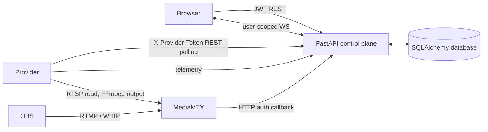

# Nexora Architecture

Status vocabulary: **IMPLEMENTED** means source evidence exists; **VERIFIED** requires successful runtime evidence. This document contains no claim of a live deployment.

## Components

| Component | Responsibility | Evidence |
| --- | --- | --- |
| Static dashboard | Hash routing, login, views, state, REST/WebSocket client | `user-website/nexora-frontend/index.html`, `js/router.js`, `js/state.js`, `js/realtime.js` |
| Control plane | API, auth, scheduler, persistence, recovery, real-time delivery | `user-website/backend/app/main.py` |
| Provider | hardware detection, heartbeat/polling, controlled workload and FFmpeg execution | `provider-server/main.py` |
| Database | Default SQLite or configured PostgreSQL | `main.py:99-108`; `docker-compose.yml`; `render.yaml` |
| MediaMTX | Optional authenticated RTMP/RTSP/WHIP relay | `infra/mediamtx.yml`, stream routes in `main.py` |

## Trust boundaries

- Browser JWTs authenticate end users. JWTs include session IDs verified against `auth_sessions`.
- All providers share one token supplied in `X-Provider-Token`; provider identity is not cryptographically bound to its ID. Treat provider calls as a weaker trust boundary.
- MediaMTX calls an unauthenticated internal callback but must present the per-session stream credential supplied in its payload.
- Destination keys are encrypted at rest with a Fernet key derived from `JWT_SECRET`; they are delivered only in provider claim responses. Rotating `JWT_SECRET` makes old encrypted values undecryptable.

## Data movement

1. User signs in; frontend stores access token and current user in browser storage.
2. User posts job requirements. Backend selects an ONLINE/AVAILABLE provider based on resources and price/reliability, reserves tokens, and persists the job.
3. Provider polls every two seconds for its assigned scheduled/recovering jobs, reports RUNNING/progress/checkpoints/result.
4. Backend persists changes and pushes filtered events to subscribed user connections. Frontend retains REST as the source of truth and resynchronizes on reconnect.
5. Provider heartbeat age is monitored every five seconds. After the configured timeout (20 seconds default), checkpoint-capable work may move to another compatible provider.

## Deployment modes

- **Direct local:** separate backend, provider, and static frontend processes; default database is SQLite.
- **Compose:** backend + Postgres + MediaMTX; uses internal MediaMTX auth callback.
- **Hosted split:** Vercel can serve static UI; Render blueprint can host backend/Postgres. MediaMTX requires a host exposing streaming TCP/UDP ports; this repository does not provision it.

## Architectural constraints

- Backend's in-memory WebSocket hub and recovery monitor are single-process constructs.
- Files are stored locally under backend `data/artifacts`, not object storage.
- Provider executes custom Python directly; there is no sandbox/container boundary.
- `frontend-vite-backup/dist` is referenced by legacy backend root-serving logic but is absent, so backend is not the supported frontend host.
