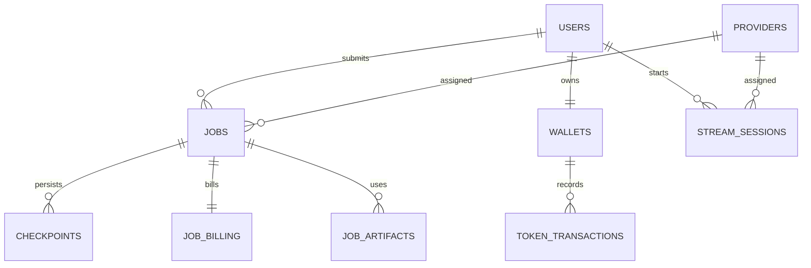

# Nexora Database Design

The database implementation is declared in `user-website/backend/app/main.py:260-346`. It is SQLAlchemy-based, SQLite by default (`sqlite:///./nexora.db`) and PostgreSQL-compatible through `DATABASE_URL`.

| Table | Key fields | Ownership/relationship |
| --- | --- | --- |
| `users` | integer `id` PK, unique `email`, `password_hash`, legacy `wallet_balance` | owns sessions/jobs/wallets/artifacts/events |
| `providers` | string `id` PK, capacity, cost, status, reliability, JSON utilization/system info, heartbeat | selected runner for jobs/streams |
| `jobs` | string PK, user/provider FKs, requirements JSON, status/progress/result, attempts/cost/times | submitted workload |
| `checkpoints` | string PK, job FK, provider ID, attempt/sequence/progress, state hash/payload JSON | durable recovery snapshots |
| `auth_sessions` | string PK, user FK/index, issued/expiry/revoked | JWT session revocation/expiry source |
| `job_artifacts` | string PK, optional job FK/index, user FK/index, file/content/checksum/meta | input/output artifacts |
| `wallets` | string PK, unique user FK, integer token balance | token source of truth |
| `token_transactions` | string PK, wallet/user/job FKs, before/after balances, reference | append-only application ledger |
| `job_billing` | job FK PK, estimated/reserved/actual tokens | one job billing state |
| `billing_transactions` | string PK, user/job FKs, kind/amount/reference | declared but not used by observed billing functions |
| `audit_events` | string PK, optional user/provider/job FKs/indexes, type/details JSON | history record |
| `stream_sessions` | string PK, user/provider FKs/indexes, state, encrypted destination credential, metrics, billing/times | remote encoding state |

## Lifecycle and consistency

- Lifespan calls `Base.metadata.create_all`; SQLite-only `ensure_schema_columns` adds selected columns to older DBs. Formal migration files are **NOT FOUND**.
- `wallet_for` auto-creates a wallet with an initial 1,000 token adjustment. Job creation reserves tokens; terminal update settles once only if `reserved_tokens > 0`.
- Artifact metadata is DB-backed while artifact content is a local backend filesystem path. No retention/deletion flow was found.
- There are no ORM relationship declarations, explicit transactions spanning distributed provider activity, or database-level uniqueness on checkpoint `(job_id, seq)`. Provider/job recovery relies on application code.
