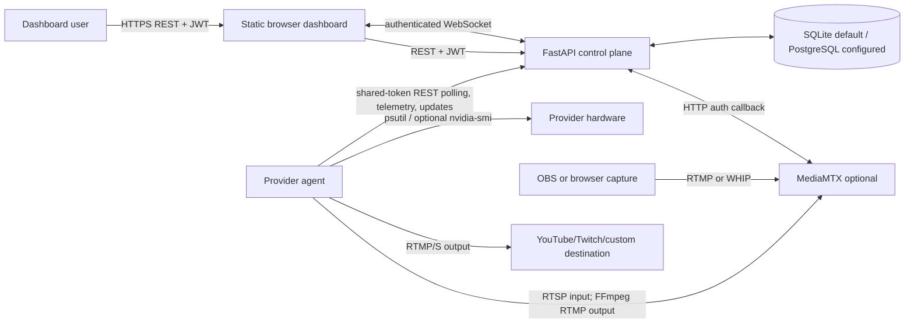
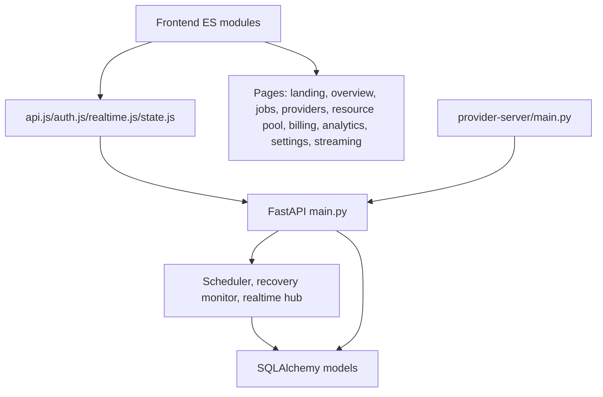
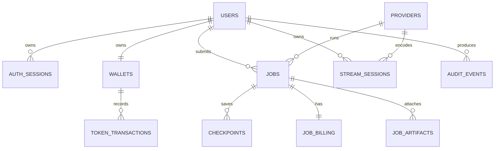

# Nexora — Unified Compute Management Platform (UCMP)

**Overall Project Report**  
**Audit date:** 25 October 2026  
**Audit basis:** repository source, configuration, tests, and non-mutating local validation. No source, dependency, environment, database, or deployment setting was changed.

## 1. Executive Summary

Nexora is an implemented prototype control plane for assigning a small set of compute workloads to separately running Python provider agents. Its browser dashboard is a static, hash-routed JavaScript application. Its FastAPI control plane owns users, sessions, providers, scheduling, job state, wallets, artifacts, checkpoints, streaming sessions, and real-time WebSocket events. Provider agents discover local hardware, authenticate with a shared provider token, send telemetry, poll for assigned jobs, execute them, and report state.

The repository implements more than a UI simulation: provider registration, heartbeat telemetry, cost/reliability-based selection, polling dispatch, four controlled CPU workloads, video-compression artifact transfer, persisted checkpoints, recovery after heartbeat loss, token accounting, and MediaMTX-based remote streaming are present in code. The tests and configuration provide evidence for many isolated behaviors, but this audit did **not** run a live provider, Docker stack, PostgreSQL, MediaMTX, remote provider, cloud deployment, or destination broadcast. Those integrations remain **UNVERIFIED** end-to-end.

The most material risks are a shared provider credential rather than per-provider identity, unsafe arbitrary Python execution on provider hosts, no durable migrations or production artifact store, scheduler/concurrency gaps, and documentation that is stale in important places.

## 2. Project Identity, Background, and Scope

| Item | Finding | Status / evidence |
| --- | --- | --- |
| Official name | Nexora — Unified Compute Management Platform | **IMPLEMENTED** terminology in `README.md` and FastAPI title at `user-website/backend/app/main.py:415`. |
| Acronym | UCMP = Unified Compute Management Platform | **IMPLEMENTED** in title/docs. |
| Category | Distributed-compute orchestration prototype with optional remote live-stream encoding | **IMPLEMENTED** code paths. |
| Problem addressed | Give a user-facing control plane a way to select heterogeneous provider machines, submit defined work, observe execution, and account for token use. | **IMPLEMENTED** in job/provider/wallet paths. |
| Users | Dashboard users and machines operated as providers; no administrator role was found. | **IMPLEMENTED / NOT FOUND**. |
| Boundary | It is not a general production scheduler, VM/container platform, payment processor, managed media host, or provider marketplace. | **VERIFIED** from implementation limits. |

The stated vision of heterogeneous compute orchestration is substantially represented by provider discovery, capacity filtering, provider selection, dispatch, telemetry, and recovery. It is not yet proven as a multi-tenant, production-grade distributed system.

## 3. Technology Stack

| Layer | Technology | Actual role | Status |
| --- | --- | --- | --- |
| Control plane | Python 3 / FastAPI 0.115.6 / Uvicorn 0.34.0 | HTTP API, WebSocket endpoint, lifespan monitor | **IMPLEMENTED**; versioned in `user-website/backend/requirements.txt`. |
| Persistence | SQLAlchemy 2.0.36; SQLite by default, PostgreSQL via psycopg 3.2.3 | ORM models and transactions; Compose/Render configuration uses PostgreSQL | **IMPLEMENTED**, database deployments **UNVERIFIED**. |
| Validation | Pydantic 2.10.3 | Request-body models and field constraints | **IMPLEMENTED**. |
| Authentication | PyJWT 2.10.1, PBKDF2-HMAC-SHA256 | 12-hour JWT sessions backed by `auth_sessions`; common provider shared token | **IMPLEMENTED**. |
| Encryption | `cryptography` / Fernet | Encrypts destination stream key using a key derived from `JWT_SECRET` | **IMPLEMENTED**, key rotation **NOT FOUND**. |
| Provider | Python, `requests` 2.32.3, `psutil` 6.1.1 | Hardware detection, telemetry, polling, controlled workload execution | **IMPLEMENTED**. |
| Media | FFmpeg (external or `imageio-ffmpeg`), MediaMTX 1.21.2 | Video probing/compression and ingest/read/transcode flow | **IMPLEMENTED**, real media path **UNVERIFIED**. |
| Frontend | Vanilla ES modules, HTML/CSS, custom SVG charts | Hash router, state store, REST client, WebSocket client | **IMPLEMENTED**. It is **not React**, contrary to `docs/architecture.md`. |
| Containers | Docker Compose, Python 3.12-slim, Postgres 16-alpine | Local backend/DB/MediaMTX topology | **IMPLEMENTED**, not executed. |
| Hosting config | Render Blueprint and Vercel static output | Suggested deployment configuration | **IMPLEMENTED**, live deployments **UNVERIFIED**. |

Dependencies were assessed from both manifests and import/use sites; no Node package manifest exists because the frontend is static.

## 4. Architecture

### System context



The media components are **IMPLEMENTED but UNVERIFIED** in a live deployment. The dashboard does not directly contact providers.

### Component relationships



Architecturally, the backend is a single-module monolith (`app/main.py`, ~1,800 lines) rather than separated controller/service/repository modules. The provider is also one process/module. This keeps a prototype simple but concentrates change risk.

### Primary job sequence

```mermaid
sequenceDiagram
  participant UI as Authenticated browser
  participant API as Control plane
  participant DB as Database
  participant P as Provider agent
  UI->>API: POST /jobs (requirements)
  API->>DB: choose compatible ONLINE provider; reserve tokens; persist job
  API-->>UI: SCHEDULED job
  P->>API: GET /providers/{id}/jobs/pending (2 s loop)
  API-->>P: assigned SCHEDULED/RECOVERING jobs
  P->>API: update RUNNING; checkpoint/update events
  API->>DB: persist state, checkpoints, token ledger
  P->>API: update COMPLETED or FAILED
  API->>DB: settle/refund reservation; release provider
  API-->>UI: REST snapshots and user-scoped WebSocket events
```

### Failure recovery sequence

```mermaid
sequenceDiagram
  participant Monitor as 5 s recovery monitor
  participant DB as Database
  participant Replacement as compatible provider
  Monitor->>DB: detect heartbeat age > HEARTBEAT_TIMEOUT_SECONDS (20 default)
  Monitor->>DB: mark failed provider OFFLINE; find latest checkpoint
  alt replacement exists
    Monitor->>DB: increment attempt, assign replacement, mark RECOVERING
    Replacement->>DB: polls pending through API
    Replacement->>Monitor: runs with latest valid checkpoint and fencing attempt
  else no replacement
    Monitor->>DB: mark job FAILED; refund reservation
  end
```

Recovery is **IMPLEMENTED** for checkpoint-capable workloads; actual multi-machine failure recovery was not executed during this audit.

## 5. Repository Coverage and Structure

| Path | Responsibility | Technology | Audit status |
| --- | --- | --- | --- |
| `user-website/backend/app/main.py` | API, persistence models, scheduler, auth, wallet, artifacts, stream sessions, WebSockets | Python/FastAPI/SQLAlchemy | Inspected |
| `provider-server/main.py` | Hardware probe, registration, heartbeats, job/stream polling and execution | Python | Inspected |
| `user-website/nexora-frontend/` | Static browser application | HTML/CSS/ES modules | Inspected all JS/CSS inventory; major flows traced |
| `user-website/backend/tests/` | API/recovery/video/stream unit and integration-style tests | pytest | Inspected; not executable because pytest absent |
| `provider-server/test_stream_runner.py` | Provider stream runner tests | pytest/unittest mocks | Inspected; not executable because pytest absent |
| `user-website/nexora-frontend/js/utils/*.test.mjs` | Browser capture and stream-stop unit tests | Node test runner | Executed successfully |
| `infra/mediamtx.yml` | MediaMTX local configuration | YAML | Inspected |
| `docker-compose.yml`, Dockerfiles | Container topology | Docker | Inspected, not executed |
| `render.yaml`, `vercel.json` | Hosting configuration | YAML/JSON | Inspected, not deployed |
| `docs/` and root documents | Instructions/claims | Markdown | Inspected; discrepancies identified |
| `.venv`, `.pytest_cache` | Generated local environment/cache | N/A | Deliberately not exhaustively inspected |
| `simulator/` | Empty directory at audit time | N/A | No implementation found |

The repository was dirty before the audit. Modified/untracked source and test files were preserved. No clear duplicate production implementation was found. `frontend-vite-backup/dist` is referenced by backend code at `main.py:538` but absent from the current inventory; the backend root route therefore falls back to a stale Vite-build message.

## 6. Functional Feature Audit

| Feature | Implementation and evidence | Status | Key limitation |
| --- | --- | --- | --- |
| Accounts/sessions | Register/login; PBKDF2 hash, `auth_sessions`, JWT with `sid`; `current_user` validates record/expiry (`main.py:242-252, 589-602, 863-871`) | **IMPLEMENTED** | No logout/revocation endpoint or password reset found. |
| Provider inventory | Shared-token registration and heartbeat store hardware/status/utilization (`874-906`) | **IMPLEMENTED** | Any holder of one shared token can impersonate any provider ID. |
| Selection | Filter online capacity/GPU/FFmpeg, choose min cost adjusted by reliability (`701-733`) | **IMPLEMENTED** | Reliability is stored but no update algorithm found; no queues, load score, or locking. |
| Controlled workloads | Matrix multiply, prime search, Fibonacci, video compression and custom Python dispatch (`provider main.py:1733-1826`) | **IMPLEMENTED** | Custom Python is arbitrary code on provider host. |
| Checkpoints/recovery | Checkpoint hashes/sequence/attempts and heartbeat-loss reassignment (`756-825`, `1028-1127`) | **IMPLEMENTED** | Recovery behavior not live-tested here; no max retry policy. |
| Artifact/video jobs | Upload, FFmpeg probe, provider download/output upload, owner download (`1182-1376`) | **IMPLEMENTED** | Files live on backend filesystem; no retention/size limit for provider output. |
| Telemetry | psutil CPU/RAM/disk; optional nvidia-smi GPU compute/memory; 5 s provider heartbeat default (`provider main.py:464-536, 674-700`) | **IMPLEMENTED** | Current telemetry only; no historical telemetry table. |
| Realtime UI | Authenticated WebSocket topics, bounded queues/rates, REST resync; frontend fallback polling | **IMPLEMENTED** | Single-process in-memory hub cannot fan out across replicas. |
| Tokens/billing | Wallet ledger, server-derived estimates/reservations/refunds/settlement (`541-588, 925-929, 999-1009`) | **IMPLEMENTED** | Demo purchases only; pricing/actual use are heuristic. |
| Live stream encoding | Session provisioning, SSRF checks, MediaMTX webhook, provider FFmpeg runner, per-minute token charges (`1383-1805`) | **IMPLEMENTED** | A real MediaMTX/OBS/browser/destination workflow was not run. |
| Resource-pool simulator | UI lets a user model scheduler filtering | **SIMULATED** | It is not a backend resource-pool entity or persistent policy. |
| Administrator controls | No role model, admin route, or administrative UI discovered | **NOT FOUND** | All normal users can see all providers through `GET /providers`. |

## 7. Backend Implementation and API Reference

The backend starts tables and a five-second recovery thread in the FastAPI lifespan (`main.py:380-413`). It loads host `.env` files only outside containers, defaults to `sqlite:///./nexora.db`, and normalizes `postgresql://` to the psycopg SQLAlchemy dialect (`33-107`). SQLite schema changes use ad-hoc `ALTER TABLE` logic (`827-855`), not migrations.

Authentication notation: **JWT** means `Authorization: Bearer <token>`; **Provider** means `X-Provider-Token`; **User** means a valid JWT. Responses are JSON unless an artifact download is noted.

| Method and path | Auth | Purpose / principal inputs | Notable outcomes |
| --- | --- | --- | --- |
| GET `/health` | none | Health check | `200 {status,service}` |
| POST `/auth/register` | none | `email`, password ≥8 | Creates user/session; `409` duplicate |
| POST `/auth/login` | none | email/password | JWT/session; `401` invalid |
| GET `/providers` | User | — | provider hardware/state list |
| POST `/providers/register` | Provider | ID/name/capacity/cost/system info | upserts provider |
| POST `/providers/{id}/heartbeat` | Provider | status/utilization | updates heartbeat and real-time telemetry |
| GET `/jobs` | User | — | caller's jobs |
| POST `/jobs` | User | name, workload, requirements | schedules/reserves; `402` insufficient tokens, `409` no provider |
| GET `/jobs/{id}` | User | ID | caller-owned job or `404` |
| POST `/jobs/{id}/cancel` | User | ID | marks cancelled/refunds reservation |
| POST `/jobs/stop-all` | User | — | marks current jobs cancelled |
| GET `/providers/{id}/jobs/pending` | Provider | ID | scheduled/recovery jobs for provider |
| POST `/providers/jobs/{id}/update` | Provider | status/progress/result/cost/attempt | updates/settles; `409` stale attempt |
| POST `/providers/jobs/{id}/checkpoint` | Provider | state/progress/attempt/hash | persists checkpoint; hash/stale checks |
| GET `/providers/jobs/{id}/checkpoint/latest` | Provider | ID | latest checkpoint |
| GET `/providers/jobs/{id}/checkpoints` | Provider | ID | checkpoint history |
| GET `/checkpoints` | User | — | caller's checkpoint rows |
| GET `/dashboard`, `/analytics`, `/billing`, `/billing/transactions` | User | — | derived dashboard, analysis, wallet and last 50 ledger entries |
| POST `/billing/purchase` | User | known `package_id` | simulated token purchase |
| POST `/billing/demo-topup` | User | demo form/card completeness | demo top-up; no card persistence |
| POST `/media/artifacts/upload` | User | multipart allowed video ≤ configured max | probe/store input artifact |
| GET `/media/artifacts/{id}` | User | ID | owner metadata |
| GET `/jobs/{job}/artifacts/{artifact}/download` | User | IDs | owner output file |
| GET `/providers/jobs/{job}/artifacts/{artifact}/download` | Provider | IDs | provider input file |
| POST `/providers/jobs/{job}/artifacts/upload` | Provider | multipart output | persists output metadata/file |
| POST `/stream/sessions` | User | source, platform, destination, profile | validates/allows one active stream, allocates provider |
| GET `/stream/sessions/active`, GET `/stream/sessions/{id}` | User | — / ID | owner stream state; active includes one-time keys |
| POST `/stream/sessions/{id}/stop` | User | ID | stop/release or requests provider stop |
| POST `/stream/internal/mediamtx/auth` | MediaMTX callback | protocol/action/path/credentials | session-scoped publish/read decision |
| GET `/providers/{id}/streams/pending` | Provider | ID | compatibility endpoint; always `[]` |
| POST `/providers/{id}/streams/claim` | Provider | ID | atomically claims session and gets scoped credentials |
| POST `/providers/streams/{id}/heartbeat` | Provider | provider/status/metrics | state/billing/STOP command |
| POST `/providers/streams/{id}/stopped` | Provider | provider/status/metrics/error | finalizes/revokes credentials |
| WS `/ws/realtime` | JWT in subprotocol | `ping`, topic subscription | user/provider/job/billing/telemetry stream |

`API_REFERENCE.md` expands the schemas, validation, side effects, and frontend callers.

## 8. Database Design

The ORM declares `users`, `providers`, `jobs`, `checkpoints`, `auth_sessions`, `job_artifacts`, `billing_transactions`, `wallets`, `token_transactions`, `job_billing`, `audit_events`, and `stream_sessions` (`main.py:260-346`). Foreign keys express the key ownership links, while primary/unique/index fields are embedded in model declarations. No declarative relationship properties, explicit non-primary indexes beyond selected FKs, database triggers, retention job, or formal migrations were found.



`DATABASE_DESIGN.md` supplies a compact field-level schema reference.

## 9. Frontend Implementation

`index.html` imports the module application. `router.js` defines landing, overview, jobs, streaming, providers, resource-pool, billing, analytics, and settings hash routes; all except landing require a local session. `api.js` persists the selected control-plane base and bearer token in browser storage, wraps fetch errors, and supports multipart upload. `state.js` fetches dashboard/jobs/providers/checkpoints/billing/analytics/active stream in one refresh; `realtime.js` connects `/ws/realtime` using a WebSocket subprotocol credential and causes REST resync when necessary. When real-time is unavailable, polling is scheduled; when it is active the client avoids parallel live-page polling.

| Screen | Data / user actions | Backend relationship |
| --- | --- | --- |
| Landing | project marketing, simulator entry, auth prompts | no required API except auth flow |
| Overview | job/node/token/aggregate current telemetry and charts | `/dashboard`, state snapshots/events |
| Jobs | list/search, submit/inspect/cancel/stop all | `/jobs`, artifact upload, cancel/stop endpoints |
| Providers | provider list/status/utilization | `/providers` and events |
| Resource pool | candidate filtering UI | **SIMULATED** client calculation against provider data |
| Billing | wallet, package/demo top-up and ledger | `/billing`, `/billing/transactions`, purchase/top-up |
| Analytics | success/recovery totals | `/analytics` |
| Settings | theme, polling/control-plane URL | local browser settings; `/health` check |
| Streaming | OBS or browser capture session flow, active metrics/stop | stream REST endpoints, MediaMTX WHIP in browser-capture mode |

No accessibility audit, WCAG test, or responsive-device verification was found or performed. The custom charts render in SVG; there is no third-party chart framework.

## 10. Compute, Telemetry, Billing, Security, and Reliability

### Execution and telemetry

The provider makes registration/heartbeat calls at a default five-second interval and polls jobs every two seconds (`provider-server/main.py:198-204, 674-700, 1914-1978`). It detects CPU/RAM/disk with psutil and GPU metrics with `nvidia-smi`, falling back to the local Torch allocator only for memory. Consequently GPU figures may be device-wide or process-only; they are not consistently a measure of Nexora job usage. The backend averages the current provider values for its dashboard (`main.py:1135-1139`). Historical telemetry persistence is **NOT FOUND**.

Job checkpoints are emitted by supported workloads, include a canonical SHA-256 state hash, and are guarded by attempt fencing. The scheduler selects rule-based candidates rather than using optimization, ML, resource pools, or preemption. Actual remote execution occurs on the provider machine as a Python process or FFmpeg subprocess; it is not container-isolated.

### Billing

The token ledger is server-owned and tracks pre/post balances. Job estimates are formula-derived from requirements; completion converts provider-reported elapsed seconds to a token count, refunds the reservation, then debits usage. Stream billing only advances after a provider reports `STREAMING` and full minutes elapse. `POST /billing/purchase` and `POST /billing/demo-topup` add predetermined token packages with no payment gateway, so money/card handling is **SIMULATED**.

### Security and reliability findings

| Priority | Finding and evidence | Impact / recommendation |
| --- | --- | --- |
| High | `custom_python` writes user source to a temporary file and executes `sys.executable -I source` (`provider-server/main.py:1758-1821`). `-I` does not sandbox code. | A dashboard user can execute code on assigned provider. Remove feature, restrict to trusted users, or use isolated containers/VMs with CPU/memory/network/file controls. |
| High | Every provider uses the same `PROVIDER_SHARED_TOKEN`; provider ID is client supplied (`main.py:686-688, 874-886`). | Token disclosure permits impersonation/update of another provider. Use per-provider credentials/certificates, rotation, and identity binding. |
| High | Default fallback values include development JWT/provider secrets (`main.py:103-104`). | Public deployment misconfiguration can be compromised. Fail startup in production when secrets are absent/weak. |
| Medium | Job cancel and stop-all mark jobs cancelled but do not signal/terminate a currently executing provider process; stop-all also does not invoke reservation refunds (`945-962`). | Incorrect billing/status and continued work are possible. Implement cancel commands, terminal-state idempotency, provider release, and consistent settlement. |
| Medium | Provider pending jobs are returned until a provider’s asynchronous RUNNING update; listener launches one thread per returned job (`provider-server/main.py:1938-1944`). | A dispatch race can create duplicate local executions. Atomically claim jobs before response or use leases. |
| Medium | In-memory WebSocket hub/recovery thread and SQLite defaults are single-instance design. | Multiple app replicas can duplicate recovery/events; SQLite has limited concurrent-write behavior. Use durable queue/locks/pubsub and migration-managed PostgreSQL. |
| Medium | Output artifact upload has no size/type/duration validation (`1319-1376`); artifacts use backend local disk. | Resource exhaustion and non-durable cloud storage. Apply limits/scanning/object store/lifecycle policy. |
| Low | CORS regex permits `https://.*.vercel.app` by default and docs/scripts use `SECRET_KEY` while code reads `JWT_SECRET`. | Broader browser trust and configuration confusion. Narrow origins and correct naming. |

## 11. Deployment and Reproducibility

Local direct-run components are supported by `README.md` and three batch scripts: run FastAPI at port 8000, provider `main.py`, and a static server at port 5173. Docker Compose defines backend, Postgres, and MediaMTX with 1935/8554/8889 TCP and 8189 UDP. Render config provisions a web service and PostgreSQL, and Vercel config serves `user-website/nexora-frontend` with SPA rewrites. The settings page can redirect the frontend to a chosen control-plane URL.

Required variable names include `DATABASE_URL`, `JWT_SECRET`, `PROVIDER_SHARED_TOKEN`, `CORS_ORIGINS`, `CORS_ORIGIN_REGEX`, `MEDIAMTX_INGEST_URL`, `MEDIAMTX_PROVIDER_READ_URL`, `MEDIAMTX_WEBRTC_URL`, `MEDIA_SERVER_ALLOW_LOOPBACK`, and `STREAM_INPUT_TIMEOUT_SECONDS`. Provider-specific names include `UCMP_BACKEND_URL`, `PROVIDER_ID`, `PROVIDER_NAME`, `HEARTBEAT_INTERVAL`, `COST_PER_HOUR`, `NEXORA_FFMPEG_PATH`, and `FFMPEG_PATH`. Values are intentionally omitted.

The exact repository commands are reproduced with caveats in `DEPLOYMENT_GUIDE.md`. No deployment was started by this audit.

## 12. Testing and Validation

| Check | Result | Meaning / limitation |
| --- | --- | --- |
| `python -m py_compile` on backend and provider | **PASSED** | Both primary Python modules parsed successfully. It does not exercise imports, API behavior, or integration. |
| `node --test js/utils/browser-capture.test.mjs js/utils/stream-stop.test.mjs` | **PASSED: 12/12** | Browser capture/WHIP error-handling and stop cleanup utility tests passed. No real browser/media server involved. |
| pytest backend/provider tests | **NOT RUN** | Existing `.venv` reported `No module named pytest`; installing was prohibited by audit scope. |
| Docker/Compose/MediaMTX | **NOT RUN** | Configuration inspected only. |
| External Render/Vercel/YouTube/Twitch | **NOT RUN** | No live credentials or deployment verification supplied. |

## 13. Documentation Discrepancies

- `docs/architecture.md` says “Browser (React)” although the current frontend is static vanilla JavaScript. It also describes only a 50% checkpoint and calls recovery future work, while current code checkpoints/recovery are implemented.
- `docs/api.md` is incomplete relative to code: it omits `/health`, analytics, transactions, artifact metadata/download/output upload, checkpoint retrieval variants, browser-capture details, and the WebSocket endpoint.
- `user-website/backend/start.bat` sets/displays `SECRET_KEY`, but code reads `JWT_SECRET`.
- Backend root route references removed `frontend-vite-backup/dist` and its fallback tells users to build `user-website/frontend`; neither aligns with current static frontend layout.
- `README.md` has a more current architecture description than `docs/architecture.md`, but its end-to-end assertions remain **UNVERIFIED** by this audit.

## 14. Limitations, Future Scope, and Conclusion

### Current limitations

1. **Live deployment and integration are unverified.** Evidence: no active execution performed; configuration/test fixtures only. Priority: high. Acceptance: repeatable local Compose and remote provider/stream smoke tests with sanitized logs.
2. **Payment is simulated.** Evidence: fixed token packages and demo top-up endpoints. Priority: medium. Acceptance: either state this permanently as demo-only or integrate a compliant payment provider with webhooks/idempotency.
3. **No persistent telemetry history, role-based administration, logout, password reset, quotas, or artifact retention policy was found.** Priority: medium.
4. **Stream infrastructure is not fully provisioned by Render.** Evidence: project docs correctly state a VM/service with TCP/UDP/TLS may be needed. Priority: high for production streaming.

### Recommended roadmap

1. Fix custom-code execution isolation and provider identity before exposing untrusted users.
2. Implement atomic job leases/cancellation and test concurrency/recovery under multiple providers.
3. Introduce Alembic-style migrations, PostgreSQL production policy, object storage, retention, and backup/restore.
4. Add provider enrollment/rotation, secret validation, audit retrieval, roles, and strict origin configuration.
5. Create a current API spec, update stale docs, and add CI that installs test dependencies and runs Python/Node suites.
6. Execute documented end-to-end deployment, media, artifact, and recovery tests with an acceptance checklist.

Nexora is a credible prototype whose core control-plane/provider workflow is implemented in source. It should be presented as a prototype with demonstrable unit-level and syntax validation, not as a verified production distributed-compute or live-streaming service.

## 15. References and Glossary

Primary evidence: `README.md`; `user-website/backend/app/main.py`; `provider-server/main.py`; `user-website/nexora-frontend/js/`; `docker-compose.yml`; `render.yaml`; `vercel.json`; `infra/mediamtx.yml`; test files under `user-website/backend/tests/` and `provider-server/test_stream_runner.py`.

**Control plane:** backend service coordinating users, providers, jobs, and state.  
**Provider:** machine/process that advertises capacity and executes work.  
**Checkpoint:** persisted workload state used after provider loss.  
**Fencing:** attempt-number check that rejects stale provider updates.  
**WHIP:** WebRTC-HTTP ingestion protocol used by browser capture.  
**MediaMTX:** separately run media server used for stream ingest/read authentication and routing.

Appendices: `ARCHITECTURE.md`, `API_REFERENCE.md`, `DATABASE_DESIGN.md`, `FEATURE_IMPLEMENTATION_MATRIX.md`, `TESTING_AND_VALIDATION.md`, `DEPLOYMENT_GUIDE.md`, and `TECHNICAL_DEBT_AND_FUTURE_SCOPE.md` are companion documents generated in this audit.
